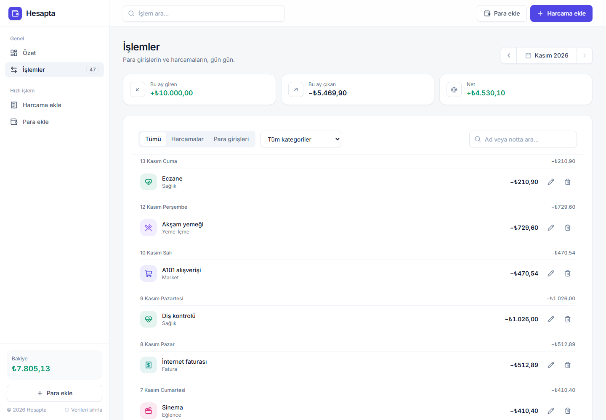
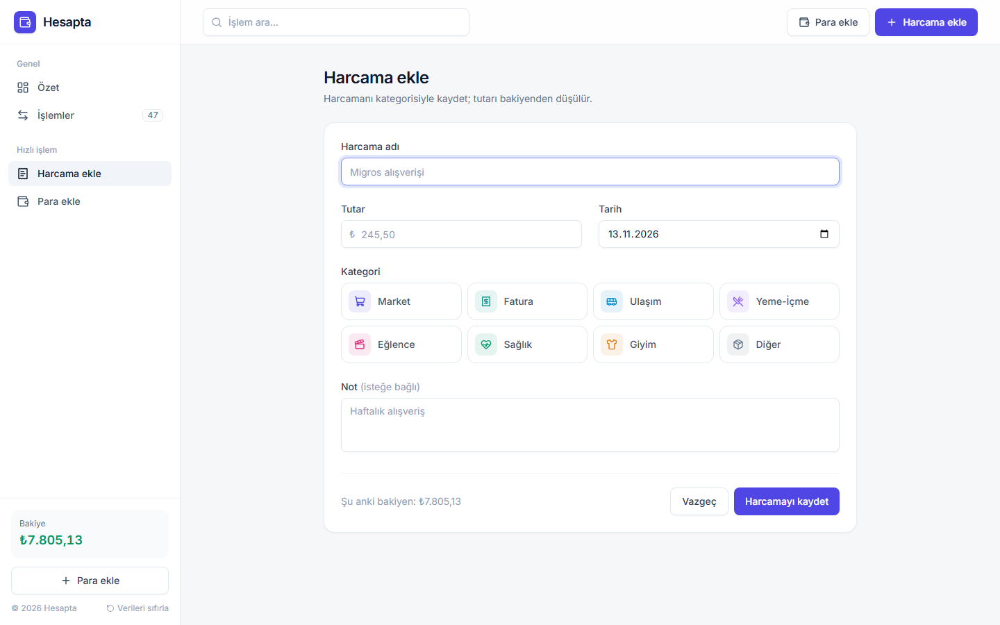
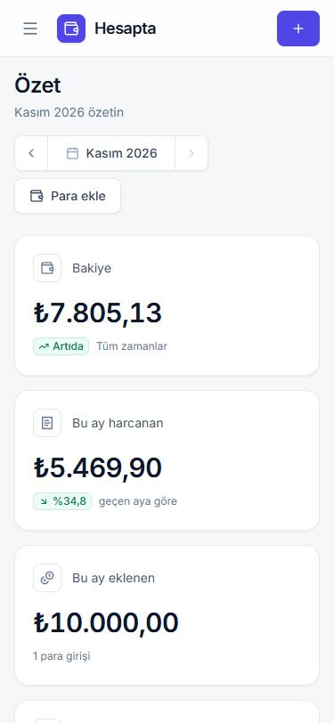

# Hesapta

Kişisel bakiye ve harcama takip uygulaması. Hesabına para ekle, harcamalarını kategorileriyle kaydet; bakiyenin ve ay ay nereye ne harcadığının özetini grafiklerle gör.

**Canlı demo:** [hesapta.netlify.app](https://hesapta.netlify.app)


| İşlemler | Harcama ekle |
|---|---|
|  |  |

<p align="center"></p>

## Özellikler

- 💰 **Bakiye:** Hesaba kategorisiz para eklenir, harcamalar bakiyeden düşer. Bakiye eksiye düşerse kırmızı gösterilir.
- 🧾 **Harcamalar:** Ad, tutar, tarih, 8 kategori ve isteğe bağlı not. Ekleme, listeleme, güncelleme ve silme.
- 📊 **Özet sayfası:** Bakiye, bu ay harcanan (geçen aya göre değişim yüzdesiyle) ve bu ay eklenen tutar.
- 📈 **Grafikler:** Son 3 ayın kategorilere göre yığılmış grafiği, günlere göre harcama ve kategori dağılımı. Hepsi kütüphanesiz, SVG ile çizildi.
- 📜 **İşlemler:** Para girişleri ve harcamalar gün gün tek listede. Ay seçici, tür ve kategori filtresi, arama.
- ✅ **Form doğrulama:** Türkçe hata mesajları. "245,50" ve "10.000" gibi Türkçe tutar yazımı destekleniyor.
- 📱 **Mobil uyumlu:** Telefonda sol menü açılır menüye dönüşür.
- ✨ **Örnek veri:** Boş başlangıçta "Örnek verilerle dene" ile son 3 ayın verileri yüklenebilir. Menüden tüm veriler sıfırlanabilir.
- 💾 Veriler tarayıcıda (LocalStorage) saklanır.

## Proje isterleri

| İster | Uygulamadaki karşılığı |
|---|---|
| **Ekle** | Harcama ekle sayfası (`/harcama/yeni`) ve "Para ekle" penceresi |
| **Listele** | İşlemler sayfası (`/islemler`) ve Özet sayfası (`/`) |
| **Güncelle** | Harcamayı düzenle sayfası (`/harcama/:id/duzenle`) |
| **Sil** | İşlemler listesindeki çöp kutusu ikonu ve düzenleme sayfası (onay penceresiyle) |
| Components / Pages / Interfaces | `src/components`, `src/pages`, `src/interfaces` |
| CSS kütüphanesi | Tailwind CSS |
| Yayın | Netlify: [hesapta.netlify.app](https://hesapta.netlify.app) (`netlify.toml`) |

## Teknolojiler

- [React 19](https://react.dev) + [TypeScript](https://www.typescriptlang.org)
- [Vite](https://vite.dev)
- [Tailwind CSS 4](https://tailwindcss.com)
- [React Router](https://reactrouter.com)
- [Lucide](https://lucide.dev) ikonları ve [Inter](https://rsms.me/inter/) yazı tipi
- [Netlify](https://www.netlify.com) (yayın)

## Kurulum

```bash
npm install
npm start
```

`npm start` geliştirme sunucusunu başlatır ve uygulamayı tarayıcıda açar (`http://localhost:5173`).

| Komut | Ne yapar |
|---|---|
| `npm start` | Geliştirme sunucusunu başlatır ve tarayıcıyı açar |
| `npm run dev` | Geliştirme sunucusunu başlatır (tarayıcıyı açmaz) |
| `npm run build` | Tip kontrolü yapar ve yayına hazır dosyaları `dist/` klasörüne üretir |
| `npm run lint` | Kodu oxlint ile denetler |

## Klasör yapısı

```
src/
├── components/
│   ├── dashboard/   Özet sayfası kartları ve grafikleri
│   ├── layout/      Sol menü, üst çubuk, sayfa iskeleti
│   └── ui/          Ortak bileşenler (Card, Modal, Badge, form alanları...)
├── pages/           Sayfalar (her rota bir sayfa)
├── interfaces/      TypeScript veri modelleri (Expense, Deposit, Category, Transaction)
├── context/         Uygulama genelindeki veri: WalletContext, WalletProvider, useWallet
├── hooks/           Özel hook'lar (seçili ayı adres çubuğunda tutan useMonthParam)
├── services/        LocalStorage okuma/yazma
├── constants/       Kategoriler ve grafik renkleri
└── utils/           Biçimlendirme (₺, tarih), hesaplamalar, doğrulama, örnek veri
```

## Veri modeli

```ts
interface Expense {   // Para çıkışı (harcama)
  id: string
  title: string
  amount: number
  categoryId: CategoryId
  date: string        // "YYYY-MM-DD"
  note?: string
  createdAt: string
}

interface Deposit {   // Para girişi (kategorisiz)
  id: string
  amount: number
  date: string
  createdAt: string
}
```

Bakiye ayrıca saklanmaz; her seferinde `toplam para girişi − toplam harcama` olarak hesaplanır. Böylece bir harcama düzenlendiğinde veya silindiğinde bakiye kendiliğinden doğru kalır.
